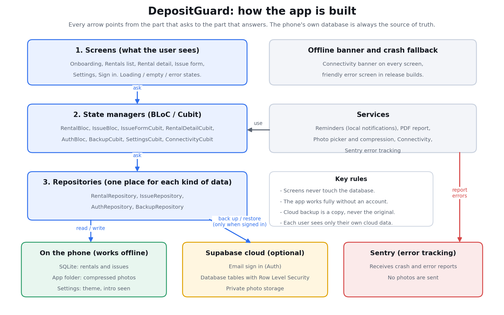
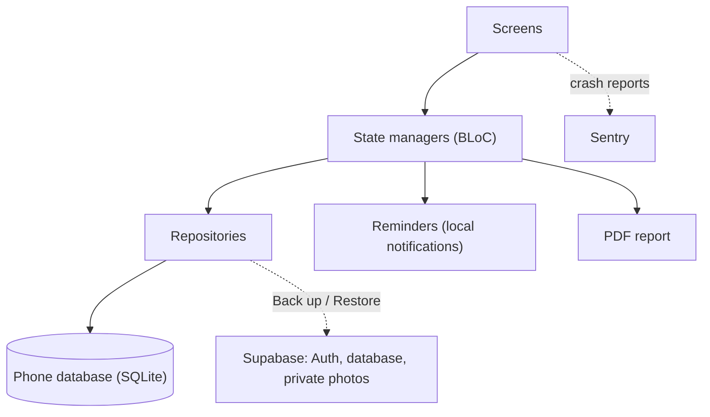

# DepositGuard

**Document your rental. Protect your deposit.**

DepositGuard is a mobile app that helps renters prove the condition of their home. At move-in the renter photographs every scratch, stain and crack. At move-out they hand the landlord a dated report, so damage that was already there cannot be taken out of the security deposit.

> One sentence: renters document the condition of their home with photos at move-in, so they can prove pre-existing damage and get their security deposit back at move-out.

---

## What the app does

| For the renter | How it works |
|---|---|
| Keep a record of each rental | Add a rental with its address and lease dates. |
| Log problems room by room | Take a photo, pick the room, severity and stage (move-in, during stay, move-out), add a note. Everything is dated. |
| Find things fast | Search, and filter by room or severity. |
| Never miss lease end | Reminders arrive 30, 7 and 1 day before the lease ends, at 9 AM. |
| Share proof | One tap creates a PDF report with photos, ready to send to the landlord. |
| Work anywhere | The app works fully offline. Nothing needs an account. |
| Keep a safe copy | Optional sign-in lets the renter back up to the cloud and restore on a new phone. |
| Make it comfortable | Light, dark or system theme. |

**No account is needed.** The app starts in guest mode and keeps everything on the phone. An account only adds cloud backup.

---

## Try it in two minutes

1. Open the APK link you were sent on an Android phone and download `app-release.apk`.
2. Open the file. If Android asks, allow installing from this source. This is normal for apps that are not yet in the Play Store.
3. Open DepositGuard and swipe through the three intro screens.
4. Tap **Add rental**, then open it and tap **Add issue** to log a problem with a photo.
5. To test cloud backup, open **Settings**, tap **Sign in or create an account** and use the demo account. The login details are sent separately in the submission message and are not stored in this repository.

### Screenshots

Add real screenshots to `docs/screenshots/` using these names.

| Rentals list                      | Rental detail                          | Add issue                            | Dark mode                        |
|-----------------------------------|----------------------------------------|--------------------------------------|----------------------------------|
| `docs/screenshots/add_issue.jpeg` | `docs/screenshots/rentals_detail.jpeg` | `docs/screenshots/rentals_list.jpeg` | `docs/screenshots/settings.jpeg` |

---

## How it is built (short version)

The screens never talk to the database directly. Each screen asks a "state manager", which asks a "repository", which reads or writes the phone's database. Cloud backup is a separate path that only runs when the user taps **Back up now**.





Full explanation: [docs/architecture.md](docs/architecture.md).

---

## For the developer

### What you need

- Flutter (stable channel) and the Android toolchain. Run `flutter doctor` and fix anything marked with a red cross.
- An Android phone with USB debugging, or an Android emulator.
- A free Supabase project and a free Sentry project (both optional, see below).

### Set up and run

```bash
git clone <https://github.com/hwb06/deposit_guard.git>
cd deposit_guard
flutter pub get
```

1. Copy `.env.example` to `.env` and fill in the values (table below). Never commit `.env`.
2. If you use Supabase: open **SQL Editor** in the Supabase dashboard, paste the whole file `supabase/backup_setup.sql` and run it once.
3. Run the app:

```bash
flutter run
```

### Environment variables

| Name | What it is | Where to find it | If it is missing |
|---|---|---|---|
| `SUPABASE_URL` | Address of your Supabase project | Supabase, Project Settings, API | App runs in guest-only mode. Sign-in and backup are hidden. |
| `SUPABASE_ANON_KEY` | Public key for the app | Supabase, Project Settings, API | Same as above. |
| `SENTRY_DSN` | Address that receives error reports | Sentry, Project Settings, Client Keys | Error tracking is off. The app still works. |

The `.env` file is bundled inside the app, so anyone can read it by unpacking the APK. That is why it may only contain the two public values above. **Never put the Supabase `service_role` key in the app, in `.env` or in this repository.**

### Build for release

Signing needs a keystore. Create it once and keep it outside the repository (steps are in [docs/launch-checklist.md](docs/launch-checklist.md)). Then create `android/key.properties` (it is git-ignored):

```properties
storePassword=YOUR_STORE_PASSWORD
keyPassword=YOUR_KEY_PASSWORD
keyAlias=upload
storeFile=C:/Users/YOURNAME/depositguard-upload.jks
```

```bash
flutter build apk --release        # APK for demos: build/app/outputs/flutter-apk/app-release.apk
flutter build appbundle --release  # AAB for the Play Store: build/app/outputs/bundle/release/app-release.aab
```

Without `android/key.properties` the build falls back to the debug key, which is fine for local testing but is not accepted by the Play Store.

### Check quality

```bash
flutter analyze   # static checks
flutter test      # unit and BLoC tests
```

---

## Security at a glance

- No secrets in the repository. `.env`, `android/key.properties` and keystores are git-ignored.
- Every cloud table and the photo bucket use **Row Level Security**: a signed-in user can only read and change their own data. Checked with a second account.
- Photos in the cloud are stored in a **private** bucket under the user's own folder.
- Android's automatic Google Drive backup is turned off for this app, so private photos are not copied there silently.
- All text fields have length limits and are validated before saving. Search text is escaped before it reaches the database.
- Errors are reported to Sentry. Photos and note text are never sent.

---

## Known limitations

- Cloud backup is manual (**Back up now**), not automatic.
- **Restore** adds missing items and updates older ones. It never deletes anything on the phone, so an item deleted later on the phone can come back after a restore.
- If a guest later signs in, that phone's local data is backed up to the account that was used.
- There is no "forgot password" screen yet and no in-app account deletion. Both are needed before a public Play Store launch (see the launch checklist).
- Reminders use on-device notifications. Server push (Firebase Cloud Messaging) is not needed for this feature and can be added later.
- The app was built and tested on Android. The project contains an iOS target, but it has not been run on an iPhone because no Mac was available.

---

## Troubleshooting

| Problem | Fix |
|---|---|
| Sign-in option is missing in Settings | `.env` is missing or the keys are wrong. Check the three values and restart with `flutter run` (not hot reload). |
| "Cloud backup isn't set up on the server yet" | Run `supabase/backup_setup.sql` in the Supabase SQL Editor. |
| No reminder notification arrives | Allow notifications for the app in Android settings and set the lease end to a date at least a day ahead. |
| Release APK installs but is not signed with your key | `android/key.properties` is missing or the path is wrong. |
| Build fails after changing the package id | Run `flutter clean`, then `flutter pub get`, then build again. |

## Documents

| Document | Purpose |
|---|---|
| [docs/product-spec.md](docs/product-spec.md) | One-page spec: user, screens, data, offline behavior |
| [docs/architecture.md](docs/architecture.md) | How the app is organised and why |
| [docs/launch-checklist.md](docs/launch-checklist.md) | Steps to publish on Google Play (and iOS notes) |
| [docs/handover-guide.md](docs/handover-guide.md) | Moving accounts to the founder |
| [docs/case-study.md](docs/case-study.md) | One-page case study |


## Try the app
The Android APK is available on request. Message me, and I will share it.

- LinkedIn: www.linkedin.com/in/hussnain-waheed-7686481a6
- Email: hussnainwaheed864@gmail.com
