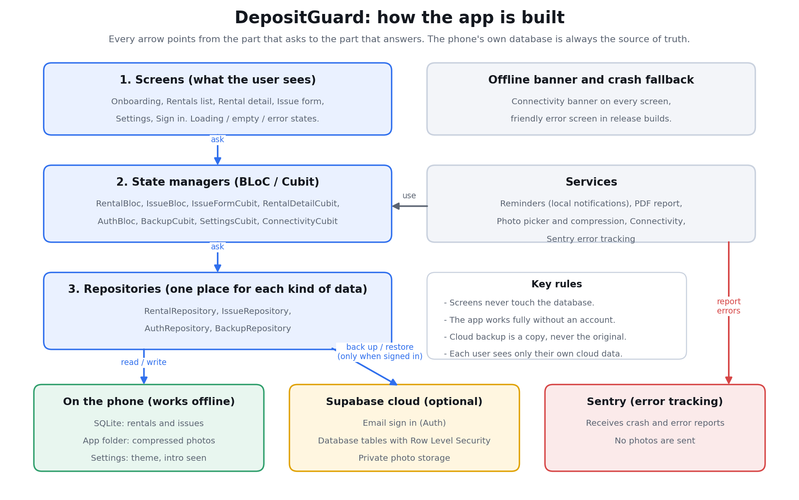
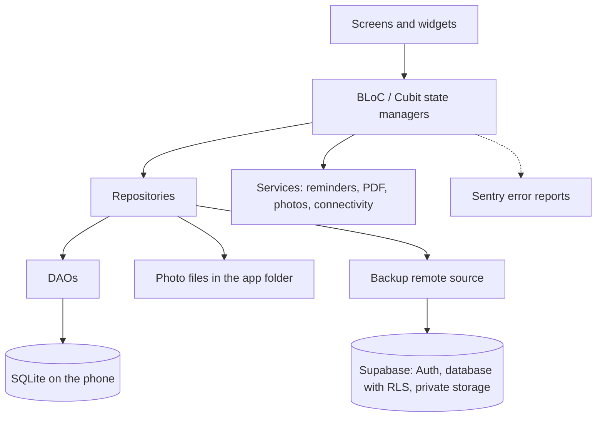
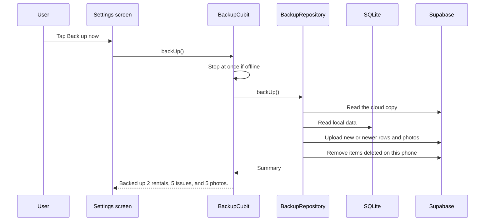

# Architecture

## The idea in plain words
The app is built in layers. Each layer only talks to the one below it. This keeps the app easy to change and easy to test.

| Layer | Folder | Job |
|---|---|---|
| Screens | `lib/presentation` | Show things and react to taps. Never touch the database. |
| State managers (BLoC / Cubit) | `lib/bloc` | Hold what the screen shows (loading, empty, error, list) and decide what happens next. |
| Repositories | `lib/data/repositories` | One place for each kind of data. Hide where the data really lives. |
| Data sources | `lib/data/local`, `lib/data/remote` | SQLite access on the phone, and Supabase access for backup. |
| Services | `lib/services` | Reminders, PDF report, photo picking, connectivity. |
| Core | `lib/core` | Colors, text, validation, router, settings loading. |

## Map

## What happens when the user adds an issue

1. The **issue form** collects the text and the photo choice.
2. The photo picker compresses the photo (longest side 1600 px, quality 80) and saves it in the app's private folder.
3. The **IssueFormCubit** asks the **IssueRepository** to save the issue.
4. The repository writes a row to **SQLite**. Only the photo's file name is stored.
5. The rental detail screen reloads its list and the issue count.

## What happens when the user taps "Back up now"

Rules the backup follows:
- The newest `updated_at` wins when an item exists in both places.
- The cloud copy is only changed for items this phone had already backed up before. A new phone with an empty database can never wipe a backup.
- Restore never deletes anything on the phone.

## Key decisions

| Decision | Why |
|---|---|
| SQLite on the phone is the source of truth | The app must work without signal and must never lose a renter's evidence. |
| Cloud backup is optional | Guests get the full app. Privacy-minded users are not forced to sign up. |
| BLoC for state | Clear states for loading, empty and error. Easy to unit test. |
| Local notifications, not Firebase push | Lease reminders are known in advance, so they work offline with no server and no extra account. Firebase can be added later for server-sent messages. |
| Row Level Security in Supabase | The database itself enforces "you only see your own data", even if the app has a bug. |
| Private photo bucket, per-user folders | Renters' photos are sensitive. Nothing is public. |
| `.env` holds only public values | The file is bundled in the app. The admin (`service_role`) key never goes near it. |
| Android auto-backup disabled | Prevents private photos from being copied to Google Drive without the user's knowledge. |

## Security checks built in
- Every form field is trimmed, limited in length and validated.
- Search text is escaped so `%` and `_` are treated as normal characters.
- Photo names from the cloud are checked before being used as file names.
- The database has its own length and value checks, matching the app.
